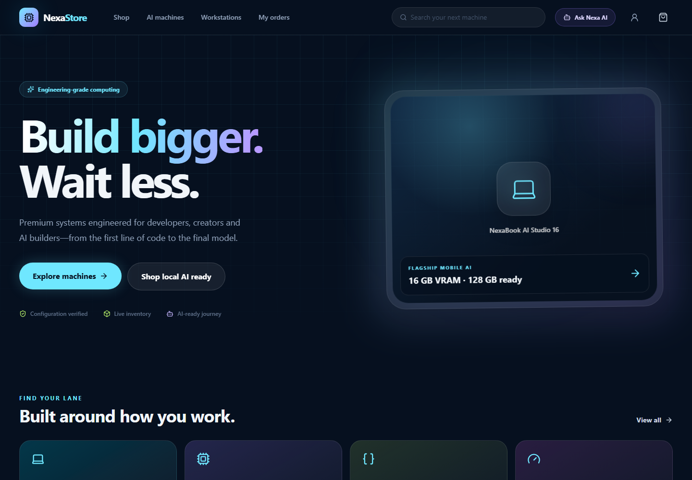
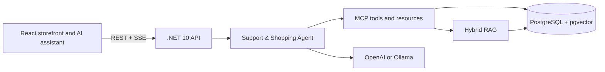

# NexaStore

### Production Agentic AI with .NET 10, React, MCP, and RAG

[](https://dotnet.microsoft.com/)
[](https://react.dev/)
[](https://www.typescriptlang.org/)
[](https://github.com/pgvector/pgvector)
[](https://docs.docker.com/compose/)
[](https://modelcontextprotocol.io/)

**Computing for Developers, Creators & AI Builders**



> Build a real e-commerce application, ground it with a PDF knowledge base,
> expose its capabilities through MCP, and evolve it into a production-oriented
> AI agent—all with modern .NET and React.

NexaStore is a production-oriented .NET 10 modular-monolith e-commerce
application that evolves incrementally into an agentic AI reference platform.
The current application combines the conventional commerce foundation with a
provider-selectable conversational AI integration. OpenAI is the cloud-first
default and Ollama remains available as a local fallback. The
assistant can query public commerce data through read-only tools and retrieve
source-grounded answers from a PostgreSQL/pgvector knowledge base. The same
read-only capabilities are published and consumed through the Model Context
Protocol (MCP) by the NexaStore Support & Shopping Agent. Governed multi-agent
collaboration remains intentionally reserved for Phase 2.

## Phase 1: available now

Phase 1 delivers an end-to-end application rather than an isolated AI demo:

- Production-ready e-commerce foundation with .NET 10, React 19, and PostgreSQL
- Provider-neutral AI through `Microsoft.Extensions.AI`
- Local Ollama and cloud OpenAI provider paths
- Streaming chat, response styles, cancellation, and Markdown rendering
- Read-only function tools over live catalog and inventory data
- PDF ingestion, OpenAI embeddings, pgvector, and idempotent indexing
- Hybrid retrieval, reranking, grounding thresholds, and exact citations
- MCP Streamable HTTP server, tools, resources, discovery, and allowlisting
- A bounded single Support & Shopping Agent that combines tools with RAG
- Docker Compose, health checks, migrations, logging, and automated tests

### Application flow



## Module 02: local LLM

- `Microsoft.Extensions.AI.IChatClient` provider abstraction
- Ollama local model integration
- Server-Sent Events streaming API
- Multi-turn React assistant experience with cancellation
- Server-owned safety and capability-boundary prompt
- Docker-managed model provisioning and persistent model storage

See [local AI documentation](docs/local-ai.md) for configuration, model selection, and manual verification.

## Module 03: prompting and streaming

- Composable, server-owned system and response-style prompts
- Concise, balanced, and detailed response modes
- Server-controlled temperature and output-token limits
- Structured `started`, `delta`, `done`, and `error` SSE events
- Ordered chunks, request correlation, elapsed-time reporting, and cancellation
- Clear-conversation and response-style controls in the React assistant

See [prompting and streaming documentation](docs/prompting-streaming.md) for the prompt architecture, streaming protocol, and module boundaries.

## Module 04: AI tools

- Automatic function invocation through `Microsoft.Extensions.AI`
- Live product search, product-detail, category, and inventory tools
- Strongly typed tool inputs and compact structured results
- Read-only allowlist with bounded catalog results and inventory quantities
- Tool-loop iteration and error limits
- Visible tool activity in the streaming React experience

See [AI tools documentation](docs/ai-tools.md) for the tool contracts, execution flow, safeguards, and module boundaries.

## Module 05: cloud LLM provider

- Direct OpenAI integration through `Microsoft.Extensions.AI`
- OpenAI cloud-first configuration with Ollama fallback
- Shared streaming and function-invocation pipeline across providers
- Startup validation for provider, credentials, endpoint, model, and timeout
- Server-only secret handling and provider-aware frontend status
- Docker Compose profiles so Ollama starts only when requested

See [cloud LLM provider documentation](docs/cloud-llm-provider.md) for secure configuration and provider switching.

## Module 06: OpenAI RAG with pgvector

- PDF extraction with page metadata across the six knowledge domains
- Overlapping, page-aware chunks and batched OpenAI embeddings
- PostgreSQL `vector(1536)` storage with an HNSW cosine index
- SHA-256 idempotent ingestion that skips unchanged documents
- Semantic-search API plus an allowlisted `search_knowledge_base` AI tool
- Document-title and page-number citations in assistant answers

See [RAG and pgvector documentation](docs/rag-pgvector.md) for ingestion, configuration, APIs, and module boundaries.

## Module 07: advanced RAG

- Hybrid dense-vector and PostgreSQL full-text retrieval
- Domain-aware query expansion and metadata/category routing
- Candidate reranking, near-duplicate removal, and relevance thresholds
- Evidence-bound citations and explicit insufficient-evidence responses
- Safe GitHub-flavored Markdown rendering in the streaming React assistant

See [advanced RAG documentation](docs/advanced-rag.md) for retrieval scoring, grounding behavior, and verification.

## Module 08: Model Context Protocol (MCP)

- Official MCP .NET SDK with Streamable HTTP transport at `/mcp`
- Runtime discovery of product, inventory, category, and knowledge tools
- A read-only `nexastore://capabilities` resource for client orientation
- Explicit tool allowlisting and fail-closed discovery validation
- MCP-backed assistant execution without coupling prompts to implementations
- Protocol-level integration coverage for discovery and tool invocation

See [MCP documentation](docs/mcp.md) for architecture, configuration, client testing, and module boundaries.

## Module 09: single support and shopping agent

- A named `NexaStore Support & Shopping Agent` with explicit goals and boundaries
- Model-driven intent routing across live commerce tools and grounded documents
- Bounded observe-decide-act execution through MCP function invocation
- Mixed workflows that combine support guidance, product matching, and inventory
- Focused clarification, evidence classification, and deterministic stop rules
- Read-only operation with no delegation, mutation, or fictional capabilities

See [single-agent documentation](docs/single-agent.md) for the orchestration loop, decision policy, configuration, and testing scenarios.

## Phase 2: coming next

Phase 2 will evolve the validated single-agent system into a governed,
observable, enterprise-ready multi-agent platform. Planned modules include:

- **JEV decision layer** — explicit judgment, evidence, and verification before consequential actions
- **Multi-agent orchestration** — specialized Sales, Product, Support, Policy, and Enterprise agents with bounded responsibilities
- **Memory and state** — short-term context, durable memory, state ownership, retention, and isolation
- **Human-in-the-loop** — approval gates, escalation, resumable workflows, and safe handling of high-impact operations
- **AG-UI experiences** — visible agent progress, tool execution, approvals, and richer interactive workflows
- **Security and safety** — identity, authorization, prompt-injection defence, content safety, secrets, and audit trails
- **Evaluation and observability** — RAG quality, agent evaluations, traces, metrics, token usage, latency, and cost monitoring
- **Local production stack** — resilient services, queues, caching, operational controls, and deployment hardening
- **Azure AI Foundry migration** — move the locally validated provider and agent architecture to Azure
- **Azure managed services** — managed search, storage, identity, secrets, monitoring, and AI services
- **AKS production deployment** — container orchestration, scaling, health, resilience, and release strategy
- **Final Agentic NexaStore** — complete enterprise architecture and end-to-end production demonstration

Phase 2 will be delivered as a deeper continuation; Phase 1 remains a complete,
runnable application with a meaningful student outcome of its own.

## Backend status

- .NET 10 ASP.NET Core REST API
- EF Core 10 with PostgreSQL
- Structured product search
- Transactional cart-to-order workflow
- Optimistic inventory/order concurrency through PostgreSQL `xmin`
- FluentValidation and ProblemDetails
- Serilog structured logging
- OpenAPI and Swagger UI
- Liveness, readiness, and combined health checks
- Unit, persistence, workflow, and HTTP integration tests

See [backend documentation](docs/backend.md) for configuration and execution.

## Frontend status

- React 19 and TypeScript 6 on Vite 8
- Tailwind CSS 4 design system and responsive premium storefront
- Product discovery, filters, product details, cart, checkout, and order history
- TanStack Query server-state management and typed Axios API boundary
- React Router route architecture with loading, error, empty, and 404 states
- Vitest and Testing Library coverage

See [frontend documentation](frontend/nexastore-web/README.md) for setup and quality commands.

## Run the complete stack

```powershell
docker compose up -d --build
```

Docker Compose applies pending EF Core migrations automatically because the API
container sets `Database__ApplyMigrationsOnStartup=true`. This includes the
`AddKnowledgeBaseVectors` migration, which enables the PostgreSQL `vector`
extension and creates the knowledge tables and HNSW index. Compose applies
existing migration files; it does not generate migrations.

When running the API outside Docker, apply the migrations manually from the
repository root. PostgreSQL must already be running, and the connection must
include the credentials from `.env`:

```powershell
docker compose up -d postgres
dotnet ef database update --project backend/NexaStore.Infrastructure --startup-project backend/NexaStore.Api --connection "Host=localhost;Port=5432;Database=nexastore;Username=nexastore;Password=<POSTGRES_PASSWORD>"
```

Create a migration only after intentionally changing the EF model, then commit
both generated migration files and the updated model snapshot. Multiple
checkouts must use the same migration files and migration ID; do not generate
another migration for an already-created schema change.

- Storefront: `http://localhost:5173`
- API and Swagger: `http://localhost:5175`
- MCP Streamable HTTP endpoint: `http://localhost:5175/mcp`
- PostgreSQL: `localhost:5432`
- Ollama (optional profile): `http://localhost:11434`

## Repository

```text
backend/        .NET solution projects
tests/          Unit and integration tests
frontend/       React storefront
knowledge-base/ Source PDF corpus for RAG ingestion
docs/           Architecture and operating documentation
```
