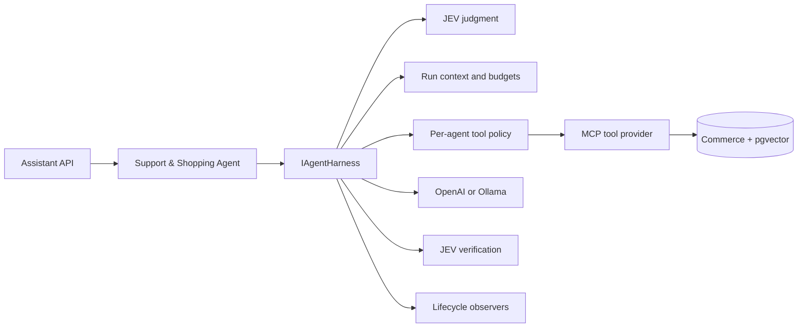

# Module 11: Agent Harness Engineering

Module 11 extracts the execution mechanics of the NexaStore Support & Shopping
Agent into a reusable agent harness. The model supplies reasoning, the agent
definition supplies identity and instructions, and the harness supplies the
controlled runtime in which the agent operates.

## Architecture



`NexaStoreSupportShoppingAgent` is intentionally thin. It supplies an
`AgentDefinition` and delegates execution to `IAgentHarness`. Future Sales,
Product, Support, Policy, and Enterprise agents can therefore reuse the same
execution controls without copying the model/tool loop.

## Harness responsibilities

The harness now owns:

- a unique run ID and structured logging scope;
- request validation and conversation-size limits;
- an overall run-duration cancellation budget;
- JEV judgment before model invocation;
- MCP/local tool discovery;
- intersection of discovered tools with the agent's explicit allowlist;
- preflight validation that required evidence tools are available;
- provider-specific model options behind `IChatClient`;
- streamed tool activity and response deltas;
- JEV evidence verification after execution; and
- typed lifecycle notifications through `IAgentRunObserver`.

## Core contracts

```text
AgentDefinition
  identity + role + instructions + allowed tools

AgentRunRequest
  conversation + response style

AgentRunContext
  run ID + agent + start time + JEV decision + available tools

IAgentHarness
  controlled execution loop

IAgentRunObserver
  tracing, evaluation, audit, and UI extension point
```

The default `LoggingAgentRunObserver` records structured lifecycle events. A
later observability module can add OpenTelemetry or evaluation observers without
changing the agent or execution loop.

## Layered controls

The controls deliberately operate at different layers:

| Control | Purpose |
|---|---|
| MCP allowlist | Limits capabilities discoverable from the MCP server |
| Agent allowlist | Limits which discovered capabilities this agent may receive |
| Maximum tool iterations | Prevents unbounded model/tool loops |
| Run duration | Cancels work that exceeds the runtime budget |
| Conversation limit | Bounds context growth before the model is called |
| JEV | Selects required evidence and verifies the result |

The harness fails closed when a JEV-required tool is not available to the
current agent. It returns an evidence-unavailable response without asking the
model to improvise an unsupported answer.

## Configuration

```json
"Agent": {
  "Name": "NexaStore Support & Shopping Agent",
  "MaximumToolIterations": 5,
  "AllowedTools": [
    "search_products",
    "get_product_details",
    "list_product_categories",
    "check_inventory",
    "search_knowledge_base"
  ]
},
"AgentHarness": {
  "Enabled": true,
  "MaximumRunDurationSeconds": 120,
  "MaximumConversationMessages": 20,
  "MaximumAvailableTools": 20
}
```

Equivalent Docker environment variables are included in `.env.example`.

## Inspect the active policy

Start the local API and call:

```powershell
Invoke-RestMethod http://localhost:5175/api/assistant/harness
```

The endpoint reports the runtime budgets, allowed tools, iteration limit, and
active harness controls without invoking the model.

## Demo workflow

1. Call `/api/assistant/harness` and explain the server-owned execution policy.
2. Ask `What is the difference between RAM and VRAM?` to show a general run.
3. Ask `Show me currently available AI-ready laptops with at least 16 GB VRAM.`
   to show governed tool discovery and invocation.
4. Ask `Summarize the return policy and cite the source.` to show the same
   harness coordinating RAG and JEV verification.
5. Ask `Add two laptops to my cart.` to show JEV blocking inside the shared
   harness before model execution.

Structured logs correlate these stages with `AgentRunId` and `AgentName`.

## Module boundary

This module implements one reusable harness around one agent. It creates the
contracts needed by multi-agent orchestration, but does not yet introduce agent
selection, delegation, handoffs, shared memory, approvals, or resumable
workflows. Those remain explicit later modules.
