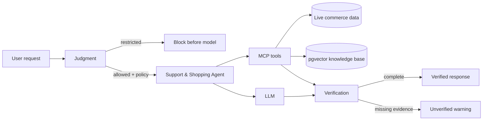

# Module 10: JEV Decision Layer

Module 10 surrounds the NexaStore Support & Shopping Agent with a deterministic
**Judgment, Evidence, and Verification (JEV)** layer. JEV does not replace the
LLM and it does not expose or persist private chain-of-thought. It applies
explicit application rules before and after the model runs.

## Why JEV exists

An agent can select tools, but a production application must not rely on the
model to decide whether its own evidence is sufficient. JEV separates three
responsibilities:

1. **Judgment** classifies the request and assigns its risk and evidence policy.
2. **Evidence** specifies which trusted tools must successfully complete.
3. **Verification** checks the observed execution and final response before the
   run is presented as grounded.

## Execution flow



The decision layer is deterministic and server-owned. The model receives the
selected route and evidence policy, but cannot weaken or bypass it.

## Routes and evidence policy

| Route | Typical request | Required evidence |
|---|---|---|
| `general` | Explain RAM versus VRAM | None |
| `commerce` | Find current AI laptops or check stock | Live product tools, plus inventory when requested |
| `knowledge` | Summarize the return policy | Knowledge-base search and a document/page citation |
| `mixed` | Use a buying guide to recommend an available laptop | Knowledge search, product search, inventory when requested, and a citation |
| `restricted` | Place an order or issue a refund | Blocked before the LLM because this agent is read-only |

Restricted requests receive a fixed capability-boundary response. This avoids
spending model tokens on an action that the application has already forbidden.

## Verification rules

JEV records a tool only after its invocation completes successfully. At the end
of a run it verifies:

- every tool required by the selected route was observed;
- the assistant produced a non-empty response;
- knowledge-grounded responses contain a document title and page citation; and
- unsupported mutations were blocked by policy.

If evidence is incomplete, the streamed answer is explicitly marked unverified.
The system does not silently convert a weak answer into a grounded one.

## Streaming contract and UI

`POST /api/assistant/chat/stream` now includes two additional SSE event types:

- `governance` contains the route, risk, evidence policy, reason code, and
  required tools;
- `verification` contains the final status, evidence used, and missing evidence.

The React assistant renders these as a JEV route badge and an **Evidence
verified** or **Evidence incomplete** badge. Existing `tool`, `delta`, `done`,
and `error` events remain unchanged.

Use `GET /api/assistant/jev` to inspect the active JEV profile without invoking
the model.

## Configuration

```json
"Jev": {
  "Enabled": true,
  "BlockUnsupportedMutations": true,
  "RequireDocumentCitations": true
}
```

Docker Compose maps the equivalent environment variables:

```text
JEV_ENABLED=true
JEV_BLOCK_UNSUPPORTED_MUTATIONS=true
JEV_REQUIRE_DOCUMENT_CITATIONS=true
```

Keep all three controls enabled for the course demo. Disabling JEV is useful
only for comparing the governed and ungoverned execution paths.

## Demo scenarios

Ask these questions in order to exercise every route:

1. `What is the difference between RAM and VRAM?`
2. `Show me AI-ready laptops with at least 16 GB VRAM.`
3. `Summarize the return policy and cite the source.`
4. `Based on the local LLM guide, recommend an available laptop.`
5. `Add two laptops to my cart.`

The first request needs no store evidence. The next three progressively require
commerce, RAG, and combined evidence. The last request demonstrates the
pre-model policy block.

## Module boundary

This module adds governance to one agent. It does not introduce multiple agent
identities, delegation, durable memory, or human approval workflows. Those are
separate modules so their state, authorization, and failure modes remain
explicit.
